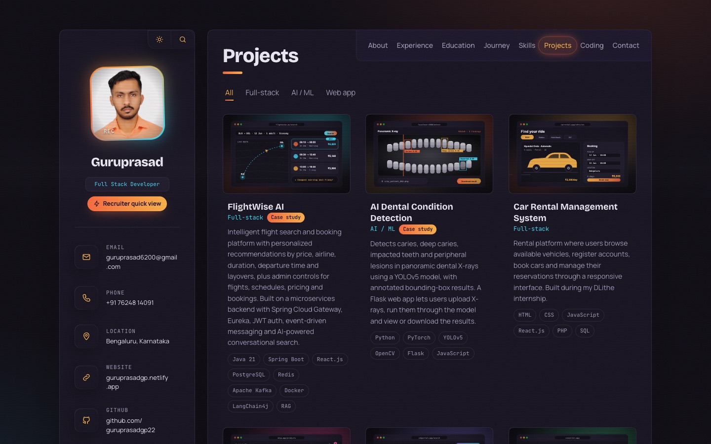
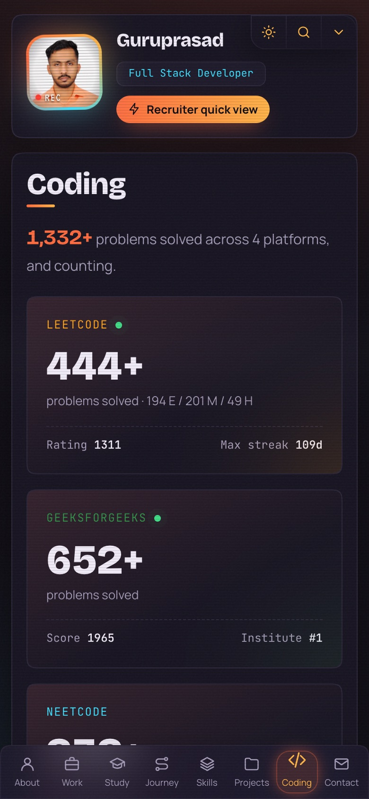

# Guruprasad · Developer Portfolio

Personal portfolio of **Guruprasad**, a full stack developer (Java · Spring Boot · Python · React.js) based in Bengaluru.

**Live site:** [guruprasadgp.netlify.app](https://guruprasadgp.netlify.app)

<p>
  
  
</p>

## Highlights

**Pages:** About · Experience · Education · Journey · Skills · Projects · Coding · Contact, in a sidebar-and-card layout. On phones the tabs move to a bottom bar.

**Motion that feels native (iOS / OxygenOS style)**
- One spring-physics setting (Framer Motion) drives tabs, cards, sheets and dialogs, so everything moves with the same weight.
- Project cards open into a full-screen detail view from where they sit, like an app opening from the home screen. Drag down to close.
- A soft highlight glides behind the active tab, buttons sink to 96% when pressed, and Android phones get a small haptic tick.
- On phones: swipe left or right to change tabs, and contacts open in a draggable bottom sheet.
- Stats roll into place like an odometer.

**Retro touches**
- An optional BIOS-style boot screen (once per visit, any key skips it) and an "old TV" channel change between pages.
- Page titles that decode with a glitch effect, CRT scanlines and film grain, a split-flap board for exam scores, and LED meters for skills.

**Useful features**
- **Live coding stats:** LeetCode, GeeksforGeeks and Code360 numbers, plus a heatmap of real LeetCode activity, load automatically (see [Live coding stats](#live-coding-stats)).
- **Case studies** for the main projects: the problem, an architecture diagram, what was hard, and where it stands.
- **Command palette:** press <kbd>⌘</kbd>/<kbd>Ctrl</kbd> + <kbd>K</kbd> to jump to any page, copy the email, download the resume or switch theme.
- **Recruiter quick view:** a one-screen summary of target roles, top skills, experience and contact buttons.
- **Light and dark themes:** the new theme spreads out in a circle from the toggle button and is remembered between visits.

**Accessibility:** every animation turns into a short fade when the visitor's device is set to reduce motion. Everything also works with the keyboard (Tab, Enter, Esc).

## Tech stack

| Area | Tools |
| --- | --- |
| UI | React 18, Vite 5, plain CSS (custom properties for theming) |
| Motion | Framer Motion (springs, shared layout), Lenis (smooth scrolling), View Transitions API |
| Data | Netlify Functions (live coding stats), cached on Netlify's CDN |
| Hosting | Netlify, deployed automatically from `main` |

## Run it locally

You need [Node.js](https://nodejs.org) 18 or newer.

```bash
git clone https://github.com/guruprasadgp22/portfolio.git
cd portfolio
npm install
npm run dev        # http://localhost:5173
```

| Command | What it does |
| --- | --- |
| `npm run dev` | Starts the dev server with hot reload |
| `npm run build` | Builds the production site into `dist/` |
| `npm run preview` | Serves the built site at http://localhost:4173 |

Live coding stats also work locally: Vite serves the same function at `/api/stats` (see `vite.config.js`).

## Updating the content

All text, numbers and links live in **[`src/data.js`](src/data.js)**, so you rarely need to touch the components. Lines marked `TODO` still need real details.

| To change | Edit in `src/data.js` |
| --- | --- |
| Name, roles, email, phone, location, social links, recruiter quick-view details | `ME` |
| Bio, stats, terminal lines, languages, interest cards | `ABOUT` |
| Jobs and internships | `EXPERIENCE` |
| Degrees and school results | `EDUCATION` |
| Certificates (add `url` to show a **Verify** link) | `CERTIFICATIONS` |
| Timeline on the Journey page | `JOURNEY` |
| Skill groups and their LED meter levels | `SKILLS` |
| Projects, cover images, case studies | `PROJECTS` |
| Coding profiles (saved numbers and profile links) | `PLATFORMS` |
| "What I'm doing" cards | `DOING` |
| Navbar tabs | `NAV` |

**Files in `public/`:**
- `me.jpg`: profile photo
- `Guruprasad_P_updated.pdf`: resume. If you rename it, update the `Resume` link in `ME.socials`.
- `projects/*.svg`: project cover art. Swap in real screenshots (PNG/JPG) and point the project's `img` at them.

**Colours and fonts** are CSS variables at the top of [`src/styles/global.css`](src/styles/global.css): `:root` holds the dark theme and `:root[data-theme="light"]` the light one.

## Live coding stats

[`netlify/functions/stats.mjs`](netlify/functions/stats.mjs) answers `GET /api/stats`. On the server it fetches:

- **LeetCode:** problems solved by difficulty, contest rating, max streak and the daily submission calendar (GraphQL)
- **GeeksforGeeks:** problems solved, coding score, institute rank
- **Code360:** problems solved by difficulty

The response is cached on Netlify's CDN for 6 hours. If a source is down, that card falls back to the numbers saved in `PLATFORMS`, so the page never breaks. NeetCode has no public data and is updated by hand. To track a different account, change `USERS` at the top of the function.

## Project structure

```
├── netlify/functions/stats.mjs   Live coding stats (Netlify Function)
├── netlify.toml                  Build command, publish folder, functions folder
├── public/                       Photo, resume, project covers, favicon
├── src/
│   ├── data.js                   All site content
│   ├── App.jsx                   Layout, page switching, swipe gestures, channel-change transition
│   ├── main.jsx                  Entry point, theme class, haptic feedback
│   ├── socials.js                Social link helpers
│   ├── styles/global.css         Theme tokens, layout, breakpoints, animations
│   ├── hooks/                    spring.js, theme.js, useStats.js, useSmoothScroll.js, useInView.js, motion.js
│   └── components/
│       ├── Sidebar.jsx, Avatar.jsx, Navbar.jsx, Overlays.jsx, Boot.jsx   Shell and overlays
│       ├── About, Experience, Education, Journey, Skills, Projects, Coding, Contact (.jsx)   Pages
│       └── ProjectDetail, Timeline, Glitch, SplitFlap, LedMeter, Odometer, Reveal, Icons (.jsx)   Building blocks
└── vite.config.js                React plugin and local /api/stats
```

## Deployment

The site is hosted on Netlify and linked to this repository. Every push to `main` builds (`npm run build`), publishes `dist/` and deploys the stats function. No environment variables are needed.

To host your own copy, create a site on Netlify from this repo. `netlify.toml` already has the right settings.

## Credits

- Layout inspired by the [vCard personal portfolio](https://github.com/codewithsadee/vcard-personal-portfolio) template by codewithsadee.
- Fonts: [Bricolage Grotesque](https://fonts.google.com/specimen/Bricolage+Grotesque), [Manrope](https://fonts.google.com/specimen/Manrope), [JetBrains Mono](https://fonts.google.com/specimen/JetBrains+Mono) and [VT323](https://fonts.google.com/specimen/VT323) from Google Fonts.

## Contact

**Guruprasad** · [guruprasad6200@gmail.com](mailto:guruprasad6200@gmail.com) · [LinkedIn](https://www.linkedin.com/in/guruprasadgp22/) · [GitHub](https://github.com/guruprasadgp22)
